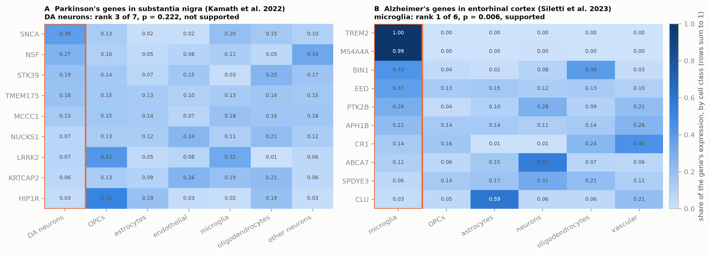
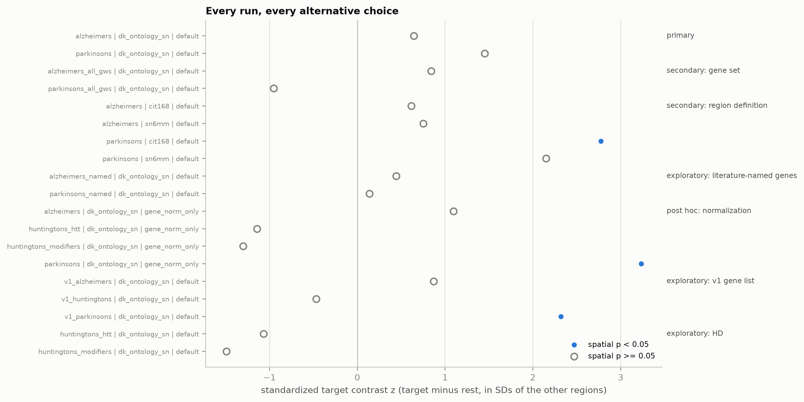

# Neurogenomic regional vulnerability

Parkinson's disease damages the substantia nigra early. Alzheimer's disease
begins in the entorhinal cortex. Huntington's disease hits the striatum. The
genes that raise risk for these diseases are expressed throughout the body.

This project asks a narrow version of the "why that region" question: are
the genes near each disease's GWAS risk loci more highly expressed, in
healthy adult brain tissue, in the region that disease damages than
elsewhere? It also asks whether that holds up against spatial
autocorrelation, comparable random gene sets, individual donors and genes,
and reasonable alternative analysis choices.

Data: Allen Human Brain Atlas microarray expression (6 donors) via
[abagen](https://abagen.readthedocs.io/), GWAS Catalog associations, GENCODE
v50, the CIT168 subcortical atlas, and GTEx v10 as an external check.

## Result (v2)

Under the analysis fixed in advance (`docs/analysis_plan.md`), neither
Parkinson's nor Alzheimer's GWAS genes show enrichment in their target region:

| Disease | Target | Target rank | Spatial p | Gene-set p | Donors with a positive contrast |
|---|---|---|---|---|---|
| Parkinson's | substantia nigra pars compacta | 7 of 44 | 0.145 | 0.221 | 4 of 6 |
| Alzheimer's | entorhinal cortex | 10 of 44 | 0.383 | 0.336 | 4 of 6 |

A Parkinson's enrichment appears only under choices that fail on other
grounds:

- substantia nigra masks drawn from sample coordinates, which turn out to
  contain mostly other midbrain and pontine tissue
- the v1 gene list, which counted one locus three times
- switching off abagen's within-sample normalization, decided post hoc

None of those clears the random gene-set null. The Huntington's gene sets are
lower in striatum than elsewhere in every donor.

The SNCA sanity check reproduces the published AHBA result (substantia nigra
pars compacta ranks 1st of 103 structures) once samples are grouped by their
anatomical labels.

Two checks added afterwards (`docs/analysis_plan_amendment_1.md`) show what
the null result can and can't say. Marker genes for dopaminergic neurons and
for striatal projection neurons rank first in their target regions in all six
donors, so the pipeline detects strong regional enrichment. The PD gene set
would have needed a contrast about three times the observed one to pass both
tests, so the result reads as "no large enrichment". A modest one isn't ruled
out.

## Result (v3): cell types inside the damaged region

Single-nucleus RNA-seq from the same tissues (Kamath et al. 2022; Siletti et
al. 2023) asks where the risk genes are expressed within each region
(`docs/analysis_plan_v3.md`, `docs/v3_results.md`).

| Disease | Tissue | Cell type tested | Rank among cell classes | p | Verdict |
|---|---|---|---|---|---|
| Alzheimer's | entorhinal cortex | microglia | 1 of 6 | 0.006 | supported |
| Parkinson's | substantia nigra | dopamine neurons | 3 of 7 | 0.22 | not supported |

AD risk genes point to microglia in every donor, carried mostly by TREM2
and MS4A4A. PD risk genes aren't specific to dopamine neurons; SNCA is the
only strongly dopamine-leaning gene. Dopamine neurons are 0.32% of
substantia nigra nuclei. For the PD risk genes, at most 4.7% of the tissue's
signal comes from them, which is why bulk regional data can't reflect a
dopamine-neuron effect on these genes. Dopamine marker genes get 13% to 88%
of their signal from those neurons, and bulk data picks them up easily.



Full results: `docs/v2_results.md`. Figures: `results/v2/figures/`.



## History

The first version (v1, commit `220b838`) reported a significant Parkinson's
result. A methods review found problems with its substantia nigra definition,
gene mapping, spatial null and donor handling. v2 rebuilt the analysis;
`docs/revision_log.md` lists every change and why. The v1 outputs are kept in
`archive/v1_exploratory/`.

## Layout

```
run_all.py                  reruns everything in order
src/
  common.py                 paths, abagen settings, shared statistics
  build_atlases.py          left-hemisphere DK atlas variants, CIT168 SN
  expression.py             one abagen extraction, then region matrices per definition
  sn_anatomy_audit.py       where the substantia nigra samples actually are
  fetch_gwas_genes.py       GWAS loci -> clumped loci -> one gene each, with audit table
  gene_probe_audit.py       why any gene is missing from AHBA
  snca_checkpoint.py        replication of Liscovitch & French 2014
  analysis.py               contrasts, spatial and gene-set nulls, donor and leave-one-out checks
  power_check.py            positive controls and power (post hoc)
  singlecell.py             v3: cell-type specificity in single-nucleus data, dilution
  gtex_check.py             external check in GTEx
  figures.py                figures 1-10
data/
  atlases/                  atlas images built by build_atlases.py
  gene_lists/               gene sets, audit tables, provenance
  processed/                sample counts, abagen check and methods text
results/
  sn_audit/, snca_checkpoint/, v2/, gtex/
docs/
  analysis_plan.md          frozen before any v2 result was computed
  analysis_plan_amendment_1.md  positive controls and power, added after the results
  v2_results.md             results and what can be claimed
  analysis_plan_v3.md       v3 plan, frozen before any single-cell value was computed
  v3_results.md             v3 results
  revision_log.md           v1 -> v2 changes
  related_work.md           verified references
archive/v1_exploratory/     v1 outputs and draft
```

## Running it

```bash
python -m venv .venv
.venv/Scripts/activate        # source .venv/bin/activate on macOS/Linux
pip install -r requirements.txt
python run_all.py
```

The first run needs internet and several GB of disk: abagen downloads about
4 GB of AHBA data to `~/abagen-data`, plus the CIT168 atlas, GENCODE v50, the
HGNC gene table, and GTEx medians into `data/raw/`. The v3 step downloads
about 5.8 GB of single-nucleus data from CELLxGENE into
`data/raw/singlecell/`. Later runs reuse the cache. `python run_all.py --from analysis` reruns only the statistics and
figures.

Versions: Python 3.11, abagen 0.1.3, BrainSMASH 0.11.0, pandas 1.5.3 (abagen
0.1.3 breaks on pandas 2.x). GWAS Catalog release 2026-09-13 (see
`data/gene_lists/provenance.json`).

## Limitations

- **Healthy tissue only.** AHBA donors are 6 adults without neurological
  disease (5 male, 1 female, ages 24 to 57). The data say nothing about
  disease mechanism, disease stage or individual risk.
- **Few samples in small regions.** Substantia nigra pars compacta has 2 to 4
  samples per donor, and entorhinal cortex 2 to 4.
- **Coordinates are unreliable at this scale.** AHBA sample coordinates don't
  place substantia nigra samples in the substantia nigra of a standard
  template, so the primary analysis uses the anatomists' labels. Regions
  defined by the Desikan-Killiany atlas mix neighbouring tissue too (for
  example, DK "putamen" includes claustrum).
- **Nearest-gene mapping isn't causal-gene mapping.** At several loci the
  nearest protein-coding gene isn't the gene usually credited (GBA1, MAPT,
  PICALM). Swapping those in doesn't change the conclusion.
- **Preprocessing matters.** abagen's within-sample normalization changes the
  substantia nigra result.
- **The spatial null is imperfect.** With 44 regions, BrainSMASH surrogates
  are less smooth than the data at short range, so spatial p-values lean
  liberal.
- **HD is a different kind of gene set.** Huntington's gene sets are the
  causal gene and onset modifiers in mutation carriers. They are analysed
  separately and only as exploratory.
- **Correlation only.** Expression in a region doesn't show that the gene
  causes damage there.

## AI assistance

Most of the code and documentation in this repository was written with
Claude, an AI assistant made by Anthropic, working from the author's project
plan and decisions. Commits it helped write carry a `Co-Authored-By: Claude`
line. The v2 rebuild followed an external methods review of v1. Competition
papers, abstracts and posters based on this project are written separately
by the author.
